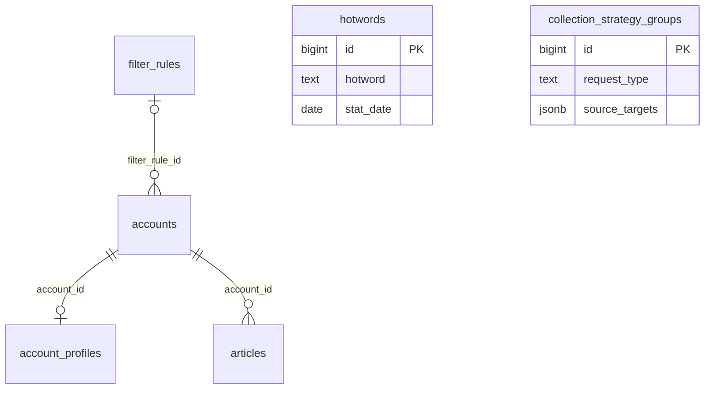

# 数据库事实与约束（只读核验）

核验时间：2026-09-20T14:22:27.761939+00:00（UTC）；项目 wechat / anikddzeystrimpvtlev / ap-northeast-1。来源为 Supabase 插件 list_tables、execute_sql、list_edge_functions、get_edge_function；本轮没有业务写入或结构更改。

本文件描述真实数据库；应用新增校验如Tag数量上限并不是现有DB约束。数据库注释和CHECK优先于猜测，业务文字标签还需与当前代码核对。原始结构见 `evidence/supabase-schema-snapshot.json`。

## 1. 六表与关系

|表|精确行数快照|RLS|
|---|---:|---|
|public.accounts|21020|已启用|
|public.account_profiles|15456|已启用|
|public.articles|9906|已启用|
|public.filter_rules|104|已启用|
|public.hotwords|11|已启用|
|public.collection_strategy_groups|2|已启用|

hotwords和策略表与其他表没有声明外键。JSON里出现account_id不等于受数据库FK保护。profiles缺失是合法情况；文章与画像依赖账号，删除账号会级联，本项目不提供账号删除。

## 2. 完整字段字典

`是`=允许SQL NULL。identity列不应由UI手填。未标编辑的画像/文章字段均只读。

### accounts

|字段|数据库类型|可空|默认/生成|界面/服务规则|
|---|---|---|---|---|
|account_id|bigint|否|IDENTITY BY DEFAULT|主键；只读|
|wx_biz|varchar(64)|否|无|精确账号身份；非空且唯一；只读|
|wx_name|varchar(128)|是|无|名称；同步维护，只读|
|verify|varchar(255)|是|无|认证主体文本；只读|
|description|text|是|无|简介；只读|
|decision_status|smallint|是|0|人工可编辑；0待审核/1通过/2过滤/3待复核来自现有UI，DB只约束数值|
|decision_source|varchar(16)|是|无|服务端随人工状态写 manual；不允许表单直接编辑|
|read_median|integer|是|无|列表中位阅读/筛选/排序的权威值；只读|
|read_max|integer|是|无|列表最高阅读权威值；只读|
|filter_rule_id|bigint|是|无|规则引用；人工状态写入时由服务端清空|
|updated_at|timestamptz|否|now()|采集更新时间语义；无 UPDATE trigger，不作为完整人工版本|

### account_profiles

|字段|数据库类型|可空|默认/生成|界面/服务规则|
|---|---|---|---|---|
|account_id|bigint|否|无|主键兼 accounts 外键；0或1份画像|
|wx_user|varchar(128)|是|无|采集/同步维护，只读|
|avatar|text|是|无|采集/同步维护，只读|
|wx_type|varchar(64)|是|无|采集/同步维护，只读|
|region|varchar(64)|是|无|采集/同步维护，只读|
|tags|jsonb|是|无|自动标签；只读|
|last_pub_time|timestamptz|是|无|采集/同步维护，只读|
|pub_count|integer|是|无|采集/同步维护，只读|
|active_days|smallint|是|无|采集/同步维护，只读|
|read_avg|integer|是|无|采集/同步维护，只读|
|read_median|integer|是|无|画像对照值；不能覆盖 accounts 同名值|
|read_max|integer|是|无|画像对照值；不能覆盖 accounts 同名值|
|burst_count|integer|是|无|采集/同步维护，只读|
|burst_rate|numeric(6,4)|是|无|原始numeric(6,4)，显示百分比须先核验业务定义|
|look_avg|integer|是|无|采集/同步维护，只读|
|look_median|integer|是|无|采集/同步维护，只读|
|look_max|integer|是|无|采集/同步维护，只读|
|like_avg|integer|是|无|采集/同步维护，只读|
|like_median|integer|是|无|采集/同步维护，只读|
|like_max|integer|是|无|采集/同步维护，只读|
|share_avg|integer|是|无|采集/同步维护，只读|
|share_median|integer|是|无|采集/同步维护，只读|
|share_max|integer|是|无|采集/同步维护，只读|
|comment_avg|integer|是|无|采集/同步维护，只读|
|comment_median|integer|是|无|采集/同步维护，只读|
|comment_max|integer|是|无|采集/同步维护，只读|
|ori_count|integer|是|无|采集/同步维护，只读|
|manual_tags|jsonb|是|无|仅此画像字段人工可编辑；应用约定字符串数组，DB未限制JSON形状|
|collected_at|timestamptz|是|无|采集时间；不能作为人工编辑版本|

### articles

|字段|数据库类型|可空|默认/生成|界面/服务规则|
|---|---|---|---|---|
|id|bigint|否|IDENTITY BY DEFAULT|主键；只读|
|account_id|bigint|否|无|外键；身份只读|
|article_sn|varchar(32)|否|无|与account_id构成业务唯一键；只读|
|idx|smallint|是|无|采集/同步维护，只读|
|title|text|否|无|采集/同步维护，只读|
|article_url|text|是|无|采集/同步维护，只读|
|published_at|timestamptz|否|无|采集/同步维护，只读|
|read_num|integer|是|无|采集/同步维护，只读|
|read_num_capped|boolean|否|false|截断标记，不应按精确值展示|
|like_num|integer|是|无|采集/同步维护，只读|
|look_num|integer|是|无|采集/同步维护，只读|
|share_num|integer|是|无|采集/同步维护，只读|
|comment_num|integer|是|无|采集/同步维护，只读|
|is_original|boolean|是|无|true/false/null三态|
|source_code|smallint|是|无|未知字典时展示原始编码|
|updated_at|timestamptz|否|now()|UPDATE trigger自动推进|

### filter_rules

|字段|数据库类型|可空|默认/生成|界面/服务规则|
|---|---|---|---|---|
|id|bigint|否|IDENTITY BY DEFAULT|真实规则ID；分组转换保留|
|scope|varchar(20)|否|无|account/article|
|field_name|varchar(50)|否|无|执行器逻辑名称，见scope组合CHECK|
|operator|varchar(20)|否|无|contains/not_contains/eq/gt/gte/lt/lte|
|value_text|text|是|无|与value_number排他，按operator决定|
|value_number|numeric|是|无|与value_text排他，numeric未限制小数位|
|enabled|boolean|否|true|可编辑，必须真boolean|
|hit_count|bigint|否|0|只读存量值，现仓库未核验统一自动递增|
|remark|varchar(255)|是|无|可编辑，最多255字符|
|created_at|timestamptz|否|now()|只读|
|updated_at|timestamptz|否|now()|UPDATE trigger自动推进；用于规则CAS|

### hotwords

|字段|数据库类型|可空|默认/生成|界面/服务规则|
|---|---|---|---|---|
|id|bigint|否|IDENTITY BY DEFAULT|主键|
|hotword|varchar(50)|否|无|可编辑标准词；最多50字符|
|aliases|text[]|是|'{}'::text[]|可编辑text[]，不是jsonb|
|stat_date|date|否|无|纯日期；本页面只读|
|article_count|smallint|否|无|合并重算，只读；2–32767|
|article_keys|text[]|是|'{}'::text[]|来源唯一键text[]；无articles外键|
|article_url|text|是|无|代表文章URL；已有高级编辑可保留|

### collection_strategy_groups

|字段|数据库类型|可空|默认/生成|界面/服务规则|
|---|---|---|---|---|
|id|bigint|否|IDENTITY BY DEFAULT|主键|
|request_type|varchar(20)|否|无|date/month/account/keyword/wx_type；不表示实际runner已支持|
|source_targets|jsonb|是|'[]'::jsonb|来源对象JSON数组，DB未检查元素形状|
|active_targets|jsonb|是|'[]'::jsonb|待请求对象JSON数组；应用保证source子集|
|completed_items|jsonb|是|'[]'::jsonb|当前轮完成项；样本仅[]，元素结构未知；默认只读|
|date|date|是|无|与month互斥|
|month|char(6)|是|无|char(6)，YYYYMM有效月份|
|cursor|smallint|否|0|0未激活；1请求1页；N请求N页；0–32767|
|min_read|integer|是|无|可空非负整数|
|max_read|integer|是|无|可空非负整数且min<=max|
|cycle_no|integer|否|1|默认1，>=1，运行进度只读|
|updated_at|timestamptz|否|now()|只有DEFAULT now()，无更新trigger；编辑时server显式推进|

## 3. CHECK、唯一键、外键完整记录

以下内容是核验结果，不是要执行的迁移SQL。

|表|约束名|定义|
|---|---|---|
|account_profiles|account_profiles_account_id_fkey|FOREIGN KEY (account_id) REFERENCES accounts(account_id) ON DELETE CASCADE|
|account_profiles|account_profiles_pkey|PRIMARY KEY (account_id)|
|accounts|accounts_decision_source_check|CHECK ((((decision_source)::text = ANY ((ARRAY['manual'::character varying, 'auto'::character varying])::text[])) OR (decision_source IS NULL)))|
|accounts|accounts_decision_status_check|CHECK ((decision_status = ANY (ARRAY[0, 1, 2, 3])))|
|accounts|accounts_filter_rule_id_fkey|FOREIGN KEY (filter_rule_id) REFERENCES filter_rules(id) ON DELETE SET NULL|
|accounts|accounts_manual_decision_no_rule_check|CHECK ((((decision_source)::text IS DISTINCT FROM 'manual'::text) OR (filter_rule_id IS NULL)))|
|accounts|accounts_pkey|PRIMARY KEY (account_id)|
|accounts|accounts_wx_biz_key|UNIQUE (wx_biz)|
|accounts|accounts_wx_biz_not_blank|CHECK ((btrim((wx_biz)::text) <> ''::text))|
|articles|articles_account_article_sn_key|UNIQUE (account_id, article_sn)|
|articles|articles_account_id_fkey|FOREIGN KEY (account_id) REFERENCES accounts(account_id) ON DELETE CASCADE|
|articles|articles_comment_num_nonnegative|CHECK (((comment_num IS NULL) OR (comment_num >= 0)))|
|articles|articles_idx_positive_or_null|CHECK (((idx IS NULL) OR (idx > 0)))|
|articles|articles_like_num_nonnegative|CHECK (((like_num IS NULL) OR (like_num >= 0)))|
|articles|articles_look_num_nonnegative|CHECK (((look_num IS NULL) OR (look_num >= 0)))|
|articles|articles_pkey|PRIMARY KEY (id)|
|articles|articles_read_num_nonnegative|CHECK (((read_num IS NULL) OR (read_num >= 0)))|
|articles|articles_share_num_nonnegative|CHECK (((share_num IS NULL) OR (share_num >= 0)))|
|collection_strategy_groups|collection_strategy_groups_cursor_check|CHECK ((cursor >= 0))|
|collection_strategy_groups|collection_strategy_groups_cycle_no_check|CHECK ((cycle_no >= 1))|
|collection_strategy_groups|collection_strategy_groups_date_month_check|CHECK ((NOT ((date IS NOT NULL) AND (month IS NOT NULL))))|
|collection_strategy_groups|collection_strategy_groups_max_read_check|CHECK (((max_read IS NULL) OR (max_read >= 0)))|
|collection_strategy_groups|collection_strategy_groups_min_read_check|CHECK (((min_read IS NULL) OR (min_read >= 0)))|
|collection_strategy_groups|collection_strategy_groups_month_check|CHECK (((month IS NULL) OR (month ~ '^[0-9]{4}(0[1-9]\|1[0-2])$'::text)))|
|collection_strategy_groups|collection_strategy_groups_pkey|PRIMARY KEY (id)|
|collection_strategy_groups|collection_strategy_groups_read_range_check|CHECK (((min_read IS NULL) OR (max_read IS NULL) OR (min_read <= max_read)))|
|collection_strategy_groups|collection_strategy_groups_request_type_check|CHECK (((request_type)::text = ANY ((ARRAY['date'::character varying, 'month'::character varying, 'account'::character varying, 'keyword'::character varying, 'wx_type'::character varying])::text[])))|
|filter_rules|filter_rules_field_scope_check|CHECK (((((scope)::text = 'account'::text) AND ((field_name)::text = ANY ((ARRAY['name'::character varying, 'verification'::character varying, 'description'::character varying, 'read_median'::character varying])::text[]))) OR (((scope)::text = 'article'::text) AND ((field_name)::text = ANY ((ARRAY['title'::character varying, 'read_count'::character varying, 'like_count'::character varying, 'comment_count'::character varying])::text[])))))|
|filter_rules|filter_rules_hit_count_check|CHECK ((hit_count >= 0))|
|filter_rules|filter_rules_operator_check|CHECK (((operator)::text = ANY ((ARRAY['contains'::character varying, 'not_contains'::character varying, 'eq'::character varying, 'gt'::character varying, 'gte'::character varying, 'lt'::character varying, 'lte'::character varying])::text[])))|
|filter_rules|filter_rules_pkey|PRIMARY KEY (id)|
|filter_rules|filter_rules_scope_check|CHECK (((scope)::text = ANY ((ARRAY['account'::character varying, 'article'::character varying])::text[])))|
|filter_rules|filter_rules_value_check|CHECK (((((operator)::text = ANY ((ARRAY['contains'::character varying, 'not_contains'::character varying])::text[])) AND (value_text IS NOT NULL) AND (value_number IS NULL)) OR (((operator)::text = ANY ((ARRAY['gt'::character varying, 'gte'::character varying, 'lt'::character varying, 'lte'::character varying])::text[])) AND (value_text IS NULL) AND (value_number IS NOT NULL)) OR (((operator)::text = 'eq'::text) AND (((value_text IS NOT NULL) AND (value_number IS NULL)) OR ((value_text IS NULL) AND (value_number IS NOT NULL))))))|
|hotwords|hotwords_article_count_check|CHECK ((article_count >= 2))|
|hotwords|hotwords_hotword_stat_date_key|UNIQUE (hotword, stat_date)|
|hotwords|hotwords_pkey|PRIMARY KEY (id)|

## 4. 索引清单与性能含义

|表|索引名|定义（只读记录）|
|---|---|---|
|account_profiles|account_profiles_pkey|CREATE UNIQUE INDEX account_profiles_pkey ON public.account_profiles USING btree (account_id)|
|accounts|accounts_decision_status_idx|CREATE INDEX accounts_decision_status_idx ON public.accounts USING btree (decision_status)|
|accounts|accounts_filter_rule_id_idx|CREATE INDEX accounts_filter_rule_id_idx ON public.accounts USING btree (filter_rule_id)|
|accounts|accounts_pkey|CREATE UNIQUE INDEX accounts_pkey ON public.accounts USING btree (account_id)|
|accounts|accounts_wx_biz_key|CREATE UNIQUE INDEX accounts_wx_biz_key ON public.accounts USING btree (wx_biz)|
|accounts|accounts_wx_name_idx|CREATE INDEX accounts_wx_name_idx ON public.accounts USING btree (wx_name)|
|articles|articles_account_article_sn_key|CREATE UNIQUE INDEX articles_account_article_sn_key ON public.articles USING btree (account_id, article_sn)|
|articles|articles_account_published_at_idx|CREATE INDEX articles_account_published_at_idx ON public.articles USING btree (account_id, published_at DESC, id DESC)|
|articles|articles_pkey|CREATE UNIQUE INDEX articles_pkey ON public.articles USING btree (id)|
|collection_strategy_groups|collection_strategy_groups_pkey|CREATE UNIQUE INDEX collection_strategy_groups_pkey ON public.collection_strategy_groups USING btree (id)|
|collection_strategy_groups|collection_strategy_groups_request_type_idx|CREATE INDEX collection_strategy_groups_request_type_idx ON public.collection_strategy_groups USING btree (request_type)|
|collection_strategy_groups|collection_strategy_groups_updated_at_idx|CREATE INDEX collection_strategy_groups_updated_at_idx ON public.collection_strategy_groups USING btree (updated_at DESC)|
|filter_rules|filter_rules_enabled_idx|CREATE INDEX filter_rules_enabled_idx ON public.filter_rules USING btree (enabled)|
|filter_rules|filter_rules_field_name_idx|CREATE INDEX filter_rules_field_name_idx ON public.filter_rules USING btree (field_name)|
|filter_rules|filter_rules_number_unique_idx|CREATE UNIQUE INDEX filter_rules_number_unique_idx ON public.filter_rules USING btree (scope, field_name, operator, value_number) WHERE (value_number IS NOT NULL)|
|filter_rules|filter_rules_pkey|CREATE UNIQUE INDEX filter_rules_pkey ON public.filter_rules USING btree (id)|
|filter_rules|filter_rules_scope_idx|CREATE INDEX filter_rules_scope_idx ON public.filter_rules USING btree (scope)|
|filter_rules|filter_rules_text_unique_idx|CREATE UNIQUE INDEX filter_rules_text_unique_idx ON public.filter_rules USING btree (scope, field_name, operator, value_text) WHERE (value_text IS NOT NULL)|
|hotwords|hotwords_hotword_stat_date_key|CREATE UNIQUE INDEX hotwords_hotword_stat_date_key ON public.hotwords USING btree (hotword, stat_date)|
|hotwords|hotwords_pkey|CREATE UNIQUE INDEX hotwords_pkey ON public.hotwords USING btree (id)|
|hotwords|hotwords_stat_date_idx|CREATE INDEX hotwords_stat_date_idx ON public.hotwords USING btree (stat_date)|

已核验没有以画像region/wx_type/active_days为键的普通索引，也没有标题/名称包含搜索的专用trigram或全文索引。不要把UI做成服务端搜索后就声称任何筛选均毫秒返回。性能不满足时应记录执行/响应证据；新建索引仍违反本包不改结构边界。

## 5. 触发器与时间戳

|表/触发器|实际效果|
|---|---|
|articles_set_updated_at|文章UPDATE前将updated_at设now()|
|articles_lock_account_limit|同账号INSERT前取得事务级advisory lock|
|articles_keep_latest_20|INSERT后删除同账号最近20条以外的数据，排序published_at DESC,id DESC|
|filter_rules_set_updated_at_trigger|规则UPDATE前将updated_at设now()|

accounts和collection_strategy_groups没有UPDATE时间触发器；account_profiles没有updated_at列；hotwords也没有updated_at。不能因为字段DEFAULT now()就以为每次UPDATE自动更新时间。核验时文章最大每账号20条，没有超过20的账号。

## 6. RLS、业务RPC、部署函数

六表RLS均开启，pg_policies未返回public行策略。常规客户端受RLS影响，当前管理工具沿用server-only访问；不开放额外RLS策略或GRANT。

public函数元数据只有rls_auto_enable事件触发器、文章相关触发器函数、filter_rules_set_updated_at；未发现可用于账号两表保存/热词合并的现成业务事务RPC。不能把触发器函数作为RPC调用来拼凑事务。

wxrank-account-sync：ACTIVE v2，verify_jwt=false，但函数内部会验证Supabase context；真实同步要求secret模式及x-wxrank-cookie。不能单看verify_jwt=false断言“完全无认证”。函数非dry-run在同步前访问jobs/job_steps；当前public不含这两表，因此不能证明真实同步可运行。dry_run仍会访问外部WxRank并可能消耗配额，本次未执行；mock_records仅校验输入，不能证明业务写链路可用。

## 7. 真实数据形状与规则分组

|作用域|字段|运算符|行数|启用|
|---|---|---|---:|---|
|account|description|contains|31|true|
|account|name|contains|35|true|
|account|read_median|lt|1|true|
|account|verification|contains|32|true|
|article|comment_count|lt|1|true|
|article|like_count|gt|1|true|
|article|read_count|gt|1|true|
|article|title|contains|2|true|

当前104条规则=98条账号文本contains（31简介+35名称+32认证）+1条账号数值规则+2条文章标题contains+3条文章数值规则。

核验数字规则：

|id|scope.field|operator|value_number|
|---:|---|---|---:|
|102|article.like_count|gt|60000|
|103|article.comment_count|lt|10|
|104|article.read_count|gt|6000|
|105|account.read_median|lt|50000|

这些值只是当前配置，不得固化在UI或执行器。尤其read_count gt 6000是实际过滤条件，不因看似不合理而自动改成lt。

策略样本：

- id=1为account：source=165，active=3，cursor=0，cycle_no=1，completed_items=[]；目标对象含account_id/wx_biz/wx_name/read_avg。
- id=2为wx_type：source=24，active=1，month=202609，cursor=0，cycle_no=1，completed_items=[]；目标为字符串。24分类完整列在02规格。
- 尚无keyword/date/month类型真实样本；不能由jsonb列推断其runner编码。

画像tags均为数组，manual_tags在核验时均为SQL NULL；因此string[]人工标签是本次应用编辑约定，不是对已有非空样本的观察。热词11行分布2个日期，核验article_count与cardinality(article_keys)一致，keys无NULL；不代表所有未来数据天然满足去重一致性，数据库只有count>=2校验。

## 8. 核验与引用边界

行数和数据状态会变化，开发时应重新只读核验。结构化证据文件保留全部字段/约束/触发器事实与聚合数据，不保存密钥、不导出全部账号内容。旧文档提到的jobs/job_steps或历史20条热词不能取代本次快照。

